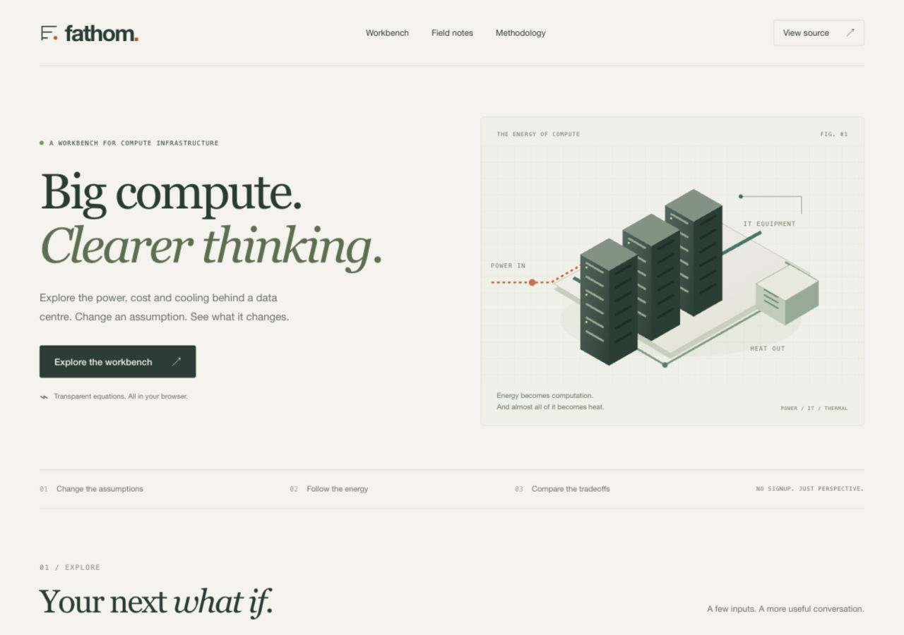

<p align="center"></p>
<h1 align="center">FATHOM</h1>
<p align="center"><strong>Power. Cooling. Perspective.</strong></p>
<p align="center">A small, transparent workbench for the energy behind compute.</p>
<p align="center"><a href="https://paulchum.github.io/fathom/">Use the workbench</a> · <a href="docs/METHODOLOGY.md">Read the equations</a> · <a href="https://github.com/paulchum/fathom/issues">Report an issue</a></p>



Change a load, compare a PUE, or follow a cooling loop. FATHOM makes the assumptions visible and keeps the results portable.

## What you can do

- **Power and cost:** estimate facility demand, annual energy and energy-only cost; compare a reference PUE at the same IT load, hours and tariff.
- **Cooling loop:** estimate captured IT heat, circulating mass/volume flow and pump electricity, with editable fluid properties and temperature rise.
- **Compare:** save up to three scenarios in this browser and load them back into the workbench.
- **Share:** copy a versioned scenario link containing the inputs in its URL fragment.
- **Export:** download JSON with inputs, results, units, assumptions and source references, or CSV for a spreadsheet.
- **Inspect:** equations, boundaries and original references are visible in the interface and [methodology](docs/METHODOLOGY.md).

No runtime dependencies, signup, analytics or application backend. Responsive layouts, keyboard-accessible controls and reduced-motion support are included.

## Run locally

Use Node.js 22 or later. There is nothing to install.

```sh
git clone https://github.com/paulchum/fathom.git
cd fathom
npm run dev
```

Open `http://127.0.0.1:4173`. Reload the page after editing files. Set `PORT` if that port is already in use. The preview server binds to loopback and serves only public application files.

```sh
npm test       # Numerical, input-validation, sharing and export checks
npm run build # Copy the public site to dist/
npm run check # Syntax, tests and production packaging
```

The application is plain HTML, CSS and ES modules. Serve `dist/` with any static host. Relative asset paths support GitHub Pages project subpaths. Open the app over HTTP, rather than directly opening `index.html` as a file.

## Example

For **1 MW average IT load**, **PUE 1.2**, **8,760 hours** and **0.10 currency units/kWh**:

| Output                               |                      Result |
| ------------------------------------ | --------------------------: |
| Average facility demand              |                      1.2 MW |
| Annual facility energy               |                  10,512 MWh |
| Energy-only annual cost              |    1,051,200 currency units |
| Cost reduction compared with PUE 1.4 | 175,200 currency units/year |

The default cooling case captures 80% of IT heat in a liquid loop. Water properties are editable screening approximations. Circulating flow is **not** water consumption. Pump input is a separate estimate and is **not added again** to PUE-based facility power.

## Project map

```text
index.html          Semantic interface, original SVG diagram and field notes
styles.css          Responsive visual system and print styles
src/model.js        Pure equations, validation and export/share formats
src/app.js          Browser interactions and local comparison storage
test/model.test.js  Reference cases, conservation and failure boundaries
scripts/            Dependency-free preview and static build
docs/               Methodology, provenance and verification notes
```

GitHub Actions runs the checks for pull requests. Pushes to `main` also publish the static site through GitHub Pages when Pages is configured to use Actions.

## Scope

FATHOM is for learning, screening and comparison. It does not predict actual PUE, certify equipment, determine site feasibility or replace an engineered design. Costs exclude demand charges, taxes, fixed costs and capital expenditure. Cooling excludes phase change, heat-exchanger capacity, temperature-limit validation and pump heat feedback.

This release is a new public browser implementation informed by earlier FATHOM infrastructure modelling. It does not include private business materials, regional GIS archives or historic source datasets. See [provenance](docs/PROVENANCE.md).

## Privacy

Calculations run locally. Saved comparisons use this browser's local storage and can be cleared in the interface. Share links contain the scenario inputs, readable by anyone with the link. There is no application telemetry; the static host may retain ordinary access logs. Do not put confidential assumptions in a link you distribute publicly.

## Licence status

**No project licence has been selected or granted.** The repository is public for inspection; public visibility does not grant a general licence to reuse, redistribute or commercialize the code. The package is marked `UNLICENSED` intentionally.

## Feedback

Reproducible numerical issues, unclear assumptions and accessibility problems are especially helpful. Include the inputs, expected result and browser version. Read [CONTRIBUTING.md](CONTRIBUTING.md) before submitting changes.
